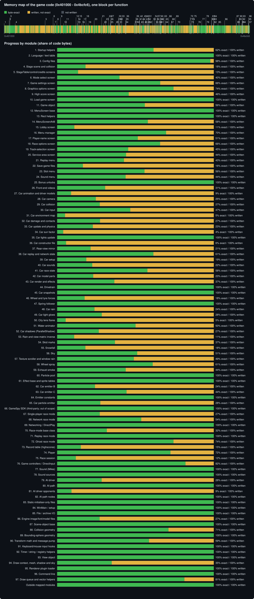
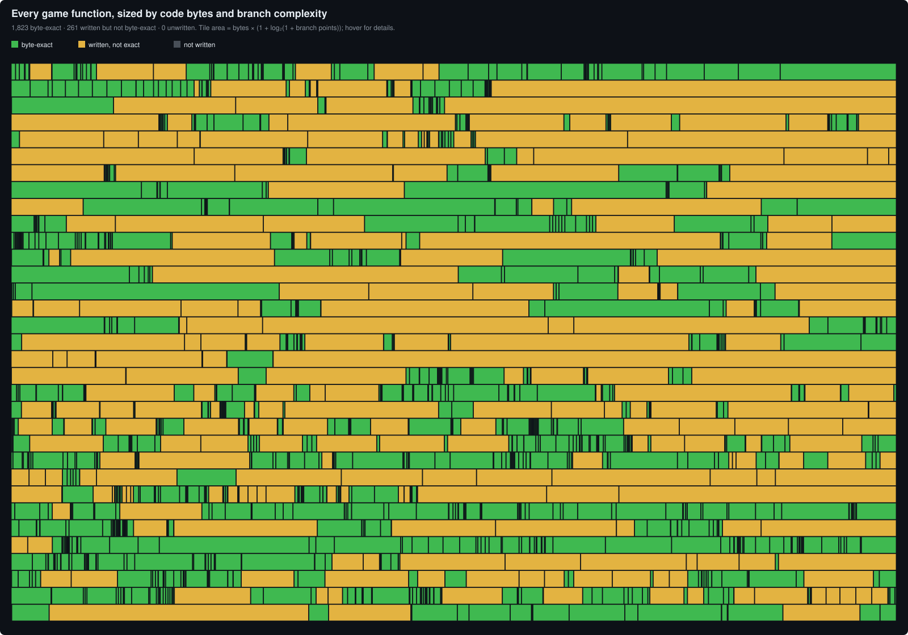

# Rally Trophy matching decomp

A byte-matching C++ reconstruction of the Rally Trophy 1.01 executable
(`orig/RallyTrophy.exe`), built with Visual C++ 6.0 SP5. Setup, toolchain and
conventions are in [`NOTES.md`](NOTES.md); the work queue and log are in
[`PROGRESS.md`](PROGRESS.md).

> These totals are regenerated by `tools/progress.py` after a full matcher pass
> and may lag the most recent commits by a few functions.

## Progress

<!-- progress:begin -->
_Updated 2026-10-28 by `tools/progress.py` (game code `0x401000`–`0x4bcfc6`)._

| | Functions | Code bytes |
|---|---|---|
| Byte-exact | 1822 / 2084 (87.43%) | 334,143 / 742,276 (45.02%) |
| Written, not yet exact | 262 | 408,133 |
| Written in total | 2084 / 2084 (100.00%) | 742,276 / 742,276 (100.00%) |

```
exact   ██████████████░░░░░░░░░░░░░░░░ 45.02% of code bytes
written ██████████████████████████████ 100.00% of code bytes
```





Progress by module (ranges in `analysis/modules.csv`):

| Module | Range | Exact / written / total | % exact | % written | |
|---|---|---|---|---|---|
| Startup helpers | `0x401000`–`0x404d50` | 59 / 65 / 65 | 65.0% | 100.0% | `████████████` |
| Language / text table | `0x404d50`–`0x405580` | 13 / 13 / 13 | 100.0% | 100.0% | `████████████` |
| Config files | `0x405580`–`0x409690` | 33 / 34 / 34 | 97.8% | 100.0% | `████████████` |
| Stage scene and collision | `0x409690`–`0x420490` | 165 / 201 / 201 | 20.3% | 100.0% | `████████████` |
| StageTable/control/credits screens | `0x420490`–`0x4266c0` | 29 / 39 / 39 | 16.3% | 100.0% | `████████████` |
| Mode select screen | `0x4266c0`–`0x427600` | 8 / 9 / 9 | 39.8% | 100.0% | `████████████` |
| Game settings screen | `0x427600`–`0x4295c0` | 10 / 11 / 11 | 65.8% | 100.0% | `████████████` |
| Graphics options screen | `0x4295c0`–`0x42c2b0` | 11 / 12 / 12 | 74.3% | 100.0% | `████████████` |
| High score screen | `0x42c2b0`–`0x42e930` | 10 / 12 / 12 | 45.7% | 100.0% | `████████████` |
| Load game screen | `0x42e930`–`0x4303e0` | 10 / 10 / 10 | 100.0% | 100.0% | `████████████` |
| Game object | `0x4303e0`–`0x437ea0` | 42 / 50 / 50 | 56.0% | 100.0% | `████████████` |
| MenuScreen base | `0x437ea0`–`0x439080` | 59 / 59 / 59 | 100.0% | 100.0% | `████████████` |
| Rect helpers | `0x439080`–`0x439170` | 5 / 5 / 5 | 100.0% | 100.0% | `████████████` |
| MenuScreenA48 | `0x439170`–`0x43a390` | 8 / 9 / 9 | 57.9% | 100.0% | `████████████` |
| Lobby screen | `0x43a390`–`0x43c590` | 8 / 12 / 12 | 11.0% | 100.0% | `████████████` |
| Menu manager | `0x43c590`–`0x43d770` | 10 / 11 / 11 | 69.6% | 100.0% | `████████████` |
| Player-name screen | `0x43d770`–`0x43f9e0` | 14 / 16 / 16 | 51.5% | 100.0% | `████████████` |
| Race options screen | `0x43f9e0`–`0x441370` | 9 / 10 / 10 | 65.7% | 100.0% | `████████████` |
| Track-selection screen | `0x441370`–`0x445e80` | 23 / 25 / 25 | 47.6% | 100.0% | `████████████` |
| Service-area screen | `0x445e80`–`0x44b930` | 16 / 22 / 22 | 44.0% | 100.0% | `████████████` |
| Replay menu | `0x44b930`–`0x44d260` | 9 / 12 / 12 | 42.6% | 100.0% | `████████████` |
| Save-game files | `0x44d260`–`0x44ea60` | 5 / 9 / 9 | 16.5% | 100.0% | `████████████` |
| Slot menu | `0x44ea60`–`0x450ee0` | 11 / 13 / 13 | 55.8% | 100.0% | `████████████` |
| Sound menu | `0x450ee0`–`0x452380` | 8 / 9 / 9 | 63.0% | 100.0% | `████████████` |
| Bonus unlocks | `0x452380`–`0x452530` | 5 / 5 / 5 | 100.0% | 100.0% | `████████████` |
| Front-end videos | `0x452530`–`0x452b20` | 4 / 4 / 4 | 100.0% | 100.0% | `████████████` |
| Car animation and driver models | `0x452b20`–`0x4563e0` | 7 / 12 / 12 | 8.9% | 100.0% | `████████████` |
| Car camera | `0x4563e0`–`0x4581f0` | 19 / 22 / 22 | 24.7% | 100.0% | `████████████` |
| Car collision | `0x4581f0`–`0x458700` | 4 / 5 / 5 | 27.2% | 100.0% | `████████████` |
| Car input | `0x458700`–`0x459230` | 27 / 28 / 28 | 46.7% | 100.0% | `████████████` |
| Car environment map | `0x459230`–`0x459890` | 6 / 7 / 7 | 5.0% | 100.0% | `████████████` |
| Car damage and contacts | `0x459890`–`0x45ad10` | 16 / 17 / 17 | 27.3% | 100.0% | `████████████` |
| Car update and physics | `0x45ad10`–`0x45dac0` | 9 / 14 / 14 | 22.8% | 100.0% | `████████████` |
| Car sun factor | `0x45dac0`–`0x45de90` | 2 / 3 / 3 | 3.9% | 100.0% | `████████████` |
| Car lights update | `0x45de90`–`0x45e480` | 3 / 3 / 3 | 100.0% | 100.0% | `████████████` |
| Car constructor file | `0x45e480`–`0x464ab0` | 20 / 24 / 24 | 10.0% | 100.0% | `████████████` |
| Rear-view mirror | `0x464ab0`–`0x4654c0` | 27 / 27 / 27 | 100.0% | 100.0% | `████████████` |
| Car replay and network state | `0x4654c0`–`0x465e90` | 12 / 13 / 13 | 61.4% | 100.0% | `████████████` |
| Car setup | `0x465e90`–`0x4666a0` | 6 / 7 / 7 | 18.6% | 100.0% | `████████████` |
| Car sounds | `0x4666a0`–`0x468720` | 9 / 11 / 11 | 22.4% | 100.0% | `████████████` |
| Car race state | `0x468720`–`0x468c40` | 7 / 8 / 8 | 57.6% | 100.0% | `████████████` |
| Car model parts | `0x468c40`–`0x469630` | 5 / 7 / 7 | 23.0% | 100.0% | `████████████` |
| Car render and effects | `0x469630`–`0x46a8a0` | 10 / 13 / 13 | 36.5% | 100.0% | `████████████` |
| Drivetrain | `0x46a8a0`–`0x46bb90` | 23 / 23 / 23 | 100.0% | 100.0% | `████████████` |
| Car snapshots | `0x46bb90`–`0x46c2c0` | 7 / 7 / 7 | 100.0% | 100.0% | `████████████` |
| Wheel and tyre forces | `0x46c2c0`–`0x46d720` | 9 / 11 / 11 | 24.4% | 100.0% | `████████████` |
| Spring follower | `0x46d720`–`0x46d830` | 5 / 5 / 5 | 100.0% | 100.0% | `████████████` |
| Car rain | `0x46d830`–`0x46e850` | 6 / 9 / 9 | 23.8% | 100.0% | `████████████` |
| Car light glows | `0x46e850`–`0x46eec0` | 12 / 13 / 13 | 28.5% | 100.0% | `████████████` |
| City lens flares | `0x46eec0`–`0x46fa80` | 4 / 6 / 6 | 5.4% | 100.0% | `████████████` |
| Water animator | `0x46fa80`–`0x46fdf0` | 5 / 6 / 6 | 50.1% | 100.0% | `████████████` |
| Car shadows (ParallelShadow) | `0x46fdf0`–`0x472c90` | 62 / 69 / 69 | 26.6% | 100.0% | `████████████` |
| Rain and view-matrix inverse | `0x472c90`–`0x4741a0` | 8 / 10 / 10 | 10.9% | 100.0% | `████████████` |
| Skid marks | `0x4741a0`–`0x474c50` | 10 / 12 / 12 | 36.9% | 100.0% | `████████████` |
| Snowfall | `0x474c50`–`0x4758b0` | 5 / 7 / 7 | 18.0% | 100.0% | `████████████` |
| Sky | `0x4758b0`–`0x476490` | 13 / 14 / 14 | 51.1% | 100.0% | `████████████` |
| Texture scroller and window rain | `0x476490`–`0x477370` | 17 / 19 / 19 | 49.0% | 100.0% | `████████████` |
| Wheel spray | `0x477370`–`0x478020` | 12 / 13 / 13 | 61.0% | 100.0% | `████████████` |
| Exhaust smoke | `0x478020`–`0x478870` | 11 / 12 / 12 | 43.8% | 100.0% | `████████████` |
| Particle pool | `0x478870`–`0x478be0` | 6 / 6 / 6 | 100.0% | 100.0% | `████████████` |
| Effect base and sprite tables | `0x478be0`–`0x479170` | 31 / 31 / 31 | 100.0% | 100.0% | `████████████` |
| Car emitter B | `0x479170`–`0x47b4c0` | 8 / 13 / 13 | 24.1% | 100.0% | `████████████` |
| Car emitter C | `0x47b4c0`–`0x47c3d0` | 8 / 9 / 9 | 44.3% | 100.0% | `████████████` |
| Emitter constants | `0x47c3d0`–`0x47c460` | 6 / 6 / 6 | 100.0% | 100.0% | `████████████` |
| Car particle emitter | `0x47c460`–`0x47ef80` | 18 / 24 / 24 | 27.6% | 100.0% | `████████████` |
| GameSpy SDK (third-party; out of scope) | `0x47ef80`–`0x4807d0` | 33 / 33 / 33 | 100.0% | 100.0% | `████████████` |
| Single-player race mode | `0x4807d0`–`0x481390` | 10 / 13 / 13 | 27.2% | 100.0% | `████████████` |
| Network race mode | `0x481390`–`0x4843e0` | 48 / 53 / 53 | 59.5% | 100.0% | `████████████` |
| Networking / DirectPlay | `0x4843e0`–`0x4856e0` | 19 / 19 / 19 | 100.0% | 100.0% | `████████████` |
| Race-mode base class | `0x4856e0`–`0x48f130` | 98 / 124 / 124 | 32.9% | 100.0% | `████████████` |
| Replay race mode | `0x48f130`–`0x48f670` | 11 / 11 / 11 | 100.0% | 100.0% | `████████████` |
| Ghost race mode | `0x48f670`–`0x48fe20` | 17 / 18 / 18 | 74.3% | 100.0% | `████████████` |
| Record table (highscores) | `0x48fe20`–`0x490950` | 6 / 11 / 11 | 15.1% | 100.0% | `████████████` |
| Player | `0x490950`–`0x491fb0` | 28 / 32 / 32 | 72.3% | 100.0% | `████████████` |
| Race session | `0x491fb0`–`0x4952e0` | 10 / 14 / 14 | 11.9% | 100.0% | `████████████` |
| Game controllers / DirectInput | `0x4952e0`–`0x498360` | 50 / 51 / 51 | 86.7% | 100.0% | `████████████` |
| Sound (Miles) | `0x498360`–`0x49b630` | 49 / 49 / 49 | 100.0% | 100.0% | `████████████` |
| Sound sources | `0x49b630`–`0x49b8e0` | 12 / 12 / 12 | 100.0% | 100.0% | `████████████` |
| AI driver | `0x49b8e0`–`0x49f910` | 23 / 28 / 28 | 28.4% | 100.0% | `████████████` |
| AI path | `0x49f910`–`0x49fee0` | 8 / 8 / 8 | 100.0% | 100.0% | `████████████` |
| AI driver opponents | `0x49fee0`–`0x4a14e0` | 4 / 8 / 8 | 9.2% | 100.0% | `████████████` |
| AI path nodes | `0x4a14e0`–`0x4a16a0` | 7 / 7 / 7 | 100.0% | 100.0% | `████████████` |
| Static-initialiser-only files | `0x4a16a0`–`0x4a1760` | 8 / 8 / 8 | 100.0% | 100.0% | `████████████` |
| WinMain / setup | `0x4a1760`–`0x4a4b10` | 45 / 45 / 45 | 100.0% | 100.0% | `████████████` |
| File / archive I/O | `0x4a4b10`–`0x4a6600` | 28 / 28 / 28 | 100.0% | 100.0% | `████████████` |
| Engine image/font/model files | `0x4a9b60`–`0x4b2830` | 52 / 73 / 73 | 27.1% | 100.0% | `████████████` |
| Scene-object base | `0x4b2830`–`0x4b3050` | 14 / 14 / 14 | 100.0% | 100.0% | `████████████` |
| Collision geometry | `0x4b3050`–`0x4b44e0` | 5 / 6 / 6 | 71.1% | 100.0% | `████████████` |
| Bounding-sphere geometry | `0x4b47e0`–`0x4b5110` | 11 / 11 / 11 | 100.0% | 100.0% | `████████████` |
| Transform math and message pump | `0x4b5140`–`0x4b6ac0` | 15 / 18 / 18 | 58.7% | 100.0% | `████████████` |
| Keyboard/mouse input hooks | `0x4b6ac0`–`0x4b7390` | 13 / 13 / 13 | 100.0% | 100.0% | `████████████` |
| Timer / string / registry helpers | `0x4b7390`–`0x4b7790` | 15 / 15 / 15 | 100.0% | 100.0% | `████████████` |
| View object | `0x4b77b0`–`0x4b7a40` | 7 / 7 / 7 | 100.0% | 100.0% | `████████████` |
| Draw context, mesh, shadow and sky | `0x4b7a40`–`0x4bbdf0` | 40 / 54 / 54 | 37.3% | 100.0% | `████████████` |
| Renderer plugin loader | `0x4bbdf0`–`0x4bc210` | 5 / 5 / 5 | 100.0% | 100.0% | `████████████` |
| Command line | `0x4bc210`–`0x4bc360` | 3 / 3 / 3 | 100.0% | 100.0% | `████████████` |
| Draw queue and vector helpers | `0x4bc360`–`0x4bcfc7` | 9 / 10 / 10 | 81.2% | 100.0% | `████████████` |
| Outside mapped modules |  | 60 / 60 / 60 | 100.0% | 100.0% | `████████████` |
<!-- progress:end -->

`// FUNCTION:` marks a function that has passed the byte matcher;
`// NONMATCHING:` marks a source body that still differs from the target.
Marker coverage does not establish behavioral equivalence. The totals above
cover the whole listed game-code inventory, including the separate GameSpy
SDK range marked third-party and out of scope; they are not a first-party-only
completion percentage. Refresh this generated block with
`python3 -I tools/progress.py` only after the full matcher passes.
